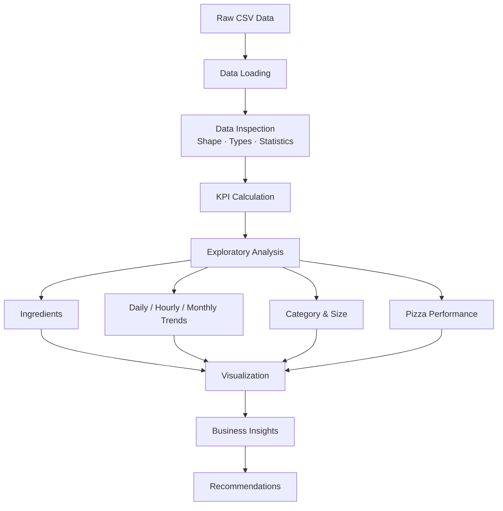

<div align="center">

# 🍕 Pizza Sales Analysis

### Exploratory Data Analysis & KPI Reporting with Python


*Turning 48,620 pizza transactions into clear, decision-ready business insights.*

</div>

---

## 📑 Table of Contents

- [Project Overview](#-project-overview)
- [Business Objectives](#-business-objectives)
- [Key Results](#-key-results)
- [Dataset](#-dataset)
- [KPI Definitions](#-kpi-definitions)
- [Analysis Workflow](#-analysis-workflow)
- [Analyses Performed](#-analyses-performed)
- [Visualizations](#-visualizations)
- [Business Recommendations](#-business-recommendations)
- [Tech Stack](#%EF%B8%8F-tech-stack)
- [Repository Structure](#-repository-structure)
- [Getting Started](#-getting-started)
- [Future Improvements](#-future-improvements)
- [Project Deliverables](#-project-deliverables)

---

## 📌 Project Overview

This capstone project analyzes one year of transactional sales data from a pizza store to uncover sales trends, product performance, and customer purchasing behavior. The analysis is built around the objectives defined in the **Business Requirements Document (BRD)** and is designed to support management decisions on:

| Area | Decision Supported |
|---|---|
| 💰 Revenue | Sales and revenue performance tracking |
| 🍕 Products | Category, size, and pizza-level performance |
| 🛒 Customers | Purchasing behavior and order value |
| ⏰ Demand | Patterns by day, month, and hour |
| 📦 Inventory | Ingredient and stock planning |
| 👥 Operations | Staffing around peak periods |
| 📣 Strategy | Menu optimization and promotions |

---

## 🎯 Business Objectives

The analysis answers the following business questions:

1. What is the total revenue generated?
2. How many pizzas were sold in total?
3. How many orders were placed?
4. Which pizza categories and sizes perform best?
5. Which pizzas are the top performers?
6. Which pizzas are the least performers?
7. What is the Average Order Value (AOV)?
8. What is the average number of pizzas per order?
9. How do orders and revenue vary by day of the week?
10. What are the hourly and monthly sales patterns?
11. Which ingredients appear most frequently across pizza types?

---

## 🏆 Key Results

| KPI | Value |
|---|---:|
| 💰 **Total Revenue** | **$817,860.05** |
| 🍕 **Total Pizzas Sold** | **49,574** |
| 🧾 **Total Orders** | **21,350** |
| 💵 **Average Order Value (AOV)** | **$38.31** |
| 📦 **Average Pizzas per Order** | **2.32** |

---

## 📊 Dataset

| Property | Detail |
|---|---|
| **File** | `pizza_sales.csv` |
| **Rows** | 48,620 |
| **Columns** | 12 |
| **Period** | January 2015 – December 2015 |
| **Grain** | One row per pizza line item within an order |

### Data Dictionary

| Column | Description |
|---|---|
| `pizza_id` | Unique identifier for a pizza transaction |
| `order_id` | Unique identifier for an order |
| `pizza_name_id` | Identifier for the pizza type |
| `quantity` | Number of pizzas sold |
| `order_date` | Date of the order |
| `order_time` | Time of the order |
| `unit_price` | Price per pizza |
| `total_price` | Revenue generated by the transaction |
| `pizza_size` | Pizza size (S, M, L, XL, XXL) |
| `pizza_category` | Category (Classic, Supreme, Veggie, Chicken) |
| `pizza_ingredients` | Ingredients used in the pizza |
| `pizza_name` | Name of the pizza |

---

## 📈 KPI Definitions

| KPI | Formula |
|---|---|
| Total Revenue | `SUM(total_price)` |
| Total Pizzas Sold | `SUM(quantity)` |
| Total Orders | `COUNT(DISTINCT order_id)` |
| Average Order Value | `Total Revenue / Total Orders` |
| Average Pizzas per Order | `Total Pizzas Sold / Total Orders` |

```python
total_revenue = df["total_price"].sum()
total_pizzas_sold = df["quantity"].sum()
total_orders = df["order_id"].nunique()

avg_order_value = total_revenue / total_orders
avg_pizzas_per_order = total_pizzas_sold / total_orders

print(f"Total Revenue: ${total_revenue:,.2f}")
print(f"Total Pizzas Sold: {total_pizzas_sold:,}")
print(f"Total Orders: {total_orders:,}")
print(f"Average Order Value: ${avg_order_value:,.2f}")
print(f"Average Pizzas per Order: {avg_pizzas_per_order:,.2f}")
```

---

## 🧠 Analysis Workflow



---

## 🔍 Analyses Performed

| # | Analysis | What It Reveals |
|:-:|---|---|
| 1 | **Data Understanding** | Shape, columns, data types, descriptive statistics, head/tail inspection |
| 2 | **KPI Analysis** | Revenue, pizzas sold, orders, AOV, pizzas per order |
| 3 | **Ingredient Analysis** | Most frequently used ingredients (split, expanded, cleaned, counted) |
| 4 | **Daily Trend** | Orders and revenue by day of week → staffing and operations |
| 5 | **Hourly Trend** | Rush periods → staffing, prep, peak-hour management |
| 6 | **Monthly Trend** | Seasonality, peak sales periods, demand changes |
| 7 | **Sales by Category** | Revenue contribution of Classic, Supreme, Veggie, Chicken |
| 8 | **Sales by Size & Category** | Category–size pivot table and heatmap |
| 9 | **Pizzas Sold by Category** | Quantity by category → inventory planning |
| 10 | **Top 5 Pizzas** | Ranked by quantity, unique orders, and revenue |
| 11 | **Bottom 5 Pizzas** | Lowest revenue → menu optimization candidates |

---

## 🖼️ Visualizations

The notebook produces the following charts:

- Total Orders by Day of Week
- Total Revenue by Day of Week
- Total Orders by Hour of Day
- Total Orders by Month
- Percentage of Sales by Pizza Category
- Percentage of Sales by Pizza Category and Size (heatmap)
- Total Pizzas Sold by Category
- Top 5 Pizzas by Quantity
- Top 5 Pizzas by Number of Orders
- Top 5 Pizzas by Revenue
- Bottom 5 Pizzas by Revenue

> 💡 **Tip:** Add screenshots of your best charts to an `outputs/charts/` folder and embed them here, for example: ``

---

## 💡 Business Recommendations

| Focus Area | Recommendation |
|---|---|
| 📣 **Marketing** | Concentrate campaigns on high-performing categories |
| 🍽️ **Menu** | Review the least-selling pizzas for redesign, promotion, or removal |
| 📦 **Inventory** | Plan stock around demand patterns and top ingredients |
| 👥 **Staffing** | Schedule teams around daily and hourly sales peaks |
| 📊 **Monitoring** | Track the core KPIs regularly for continuous improvement |

---

## 🛠️ Tech Stack

| Tool | Purpose |
|---|---|
| **Python** | Core programming language |
| **Pandas** | Data loading, cleaning, transformation, aggregation |
| **NumPy** | Numerical operations |
| **Matplotlib** | Charts and visualizations |
| **Seaborn** | Statistical plots and heatmaps |
| **Plotly Express** | Interactive visualizations |
| **Jupyter Notebook** | Analysis environment |

---

## 📂 Repository Structure

```text
python/
│
├── README.md
├── requirements.txt
│
├── data/
│   └── pizza_sales.csv
│
├── notebooks/
│   └── Pizza_Sales_Analysis.ipynb
│
└── outputs/
    └── charts/
```

---

## 🚀 Getting Started

### 1. Clone the repository

```bash
git clone <your-repository-url>
cd <your-repository-folder>/python
```

### 2. Create a virtual environment

**Windows**
```bash
python -m venv .venv
.venv\Scripts\activate
```

**macOS / Linux**
```bash
python3 -m venv .venv
source .venv/bin/activate
```

### 3. Install dependencies

Create a `requirements.txt` file:

```text
pandas
numpy
matplotlib
seaborn
plotly
jupyter
```

Then install:

```bash
pip install -r requirements.txt
```

### 4. Launch the notebook

```bash
jupyter notebook
```

Open `notebooks/Pizza_Sales_Analysis.ipynb` and run all cells.

> ⚠️ **Note:** Load the dataset with a relative path so the notebook runs on any machine:
> ```python
> df = pd.read_csv("../data/pizza_sales.csv")
> ```

---

## 🔮 Future Improvements

- [ ] Refactor KPI calculations into reusable functions
- [ ] Split code into modules (`data_loading.py`, `kpi_analysis.py`, `visualizations.py`)
- [ ] Add automated data-quality checks and unit tests
- [ ] Export KPI summaries to Excel / CSV
- [ ] Build an interactive dashboard (Power BI, Streamlit, or Plotly Dash)
- [ ] Add a dedicated business-insights report

---

## 📦 Project Deliverables

- ✅ Business Requirements Document (BRD)
- ✅ Jupyter Notebook with the full Python analysis
- ✅ Sales visualizations
- ✅ KPI analysis
- ✅ Business insights and recommendations

---

<div align="center">

**Focus:** Exploratory Data Analysis · KPI Analysis · Sales Trends · Product Performance · Business Insights

⭐ If you found this project useful, consider giving it a star!

</div>
