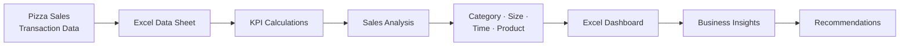

<div align="center">

# 📗 05 — Excel Analysis & Dashboard

### Pizza Sales Analysis | Microsoft Excel


*Transforming pizza sales transactions into KPIs, trends, and a management-ready dashboard.*

</div>

---

## 📑 Table of Contents

- [Objective](#-objective)
- [Folder Contents](#-folder-contents)
- [Workbook Structure](#-workbook-structure)
- [Key KPIs](#-key-kpis)
- [Analysis Covered](#-analysis-covered)
- [Business Questions Answered](#-business-questions-answered)
- [Business Decisions Supported](#-business-decisions-supported)
- [Excel Techniques Used](#%EF%B8%8F-excel-techniques-used)
- [Analysis Flow](#-analysis-flow)
- [Data & Interpretation Notes](#%EF%B8%8F-data--interpretation-notes)
- [Project Context](#-project-context)
- [Deliverable](#-deliverable)

---

## 🎯 Objective

This folder contains the Excel-based analysis and dashboard for the **Pizza Sales Analysis** project. Using Microsoft Excel, it turns raw pizza sales transactions into meaningful KPIs, sales trends, and product performance insights that support management decision-making.

The analysis evaluates:

- 💰 Revenue and order performance
- 🍕 Pizza quantity sold
- 💵 Average Order Value (AOV) and Average Pizzas per Order
- 🗂️ Category and size performance
- 📅 Day-wise and time-based sales
- 🏆 Best-selling and least-selling pizzas

---

## 📂 Folder Contents

```text
05_Excel/
├── Pizza Dashboard.xlsx
└── README.md
```

| File | Description |
|---|---|
| `Pizza Dashboard.xlsx` | Main workbook containing the source data, analysis sheets, and the final dashboard |
| `README.md` | Documentation for this folder |

---

## 📘 Workbook Structure

| Sheet | Purpose |
|---|---|
| `pizza_sales` | Transactional sales data used as the analysis source |
| `KPI's` | Total Revenue, Total Pizzas Sold, Total Orders, AOV, and Average Pizzas per Order |
| `Sales by Category` | Revenue and quantity analysis by pizza category |
| `Size wize Sales` | Sales performance by pizza size |
| `Day wise Sales` | Sales performance across days and order times |
| `Best and Worst Selling Pizza` | Strongest and weakest product performance |
| `Dashboard` | Consolidated management-level view of key metrics and analysis |

---

## 📈 Key KPIs

| KPI | Definition |
|---|---|
| 💰 **Total Revenue** | Sum of `total_price` |
| 🍕 **Total Pizzas Sold** | Sum of `quantity` |
| 🧾 **Total Orders** | Count of unique `order_id` |
| 💵 **Average Order Value (AOV)** | Total Revenue ÷ Total Orders |
| 📦 **Average Pizzas per Order** | Total Pizzas Sold ÷ Total Orders |

---

## 🔍 Analysis Covered

| Area | What Is Analyzed |
|---|---|
| **Overall Performance** | Revenue, orders, pizzas sold, AOV, and average pizzas per order |
| **Category Performance** | Revenue and quantity by pizza category |
| **Size Performance** | Revenue and quantity by pizza size |
| **Time-Based Performance** | Day-wise and order-time patterns |
| **Product Performance** | Best-selling and least-selling pizzas |

---

## ❓ Business Questions Answered

1. What is the total revenue generated?
2. How many pizzas were sold?
3. How many orders were placed?
4. What is the Average Order Value?
5. What is the average number of pizzas per order?
6. Which pizza category performs best?
7. Which pizza size performs best?
8. Which pizzas are the best sellers?
9. Which pizzas are the least sellers?
10. How do sales vary by day?
11. What are the major sales patterns visible in the data?

---

## 🧭 Business Decisions Supported

| Goal | Supported By |
|---|---|
| 📈 **Improve sales performance** | Revenue, orders, and pizzas sold |
| 👥 **Plan staffing** | Day-wise and time-based sales |
| 🍽️ **Optimize the menu** | Pizza, category, and size performance |
| 📦 **Plan inventory** | Pizza quantity and size demand |
| 📣 **Improve promotions** | Best and least-performing pizzas |

---

## 🛠️ Excel Techniques Used

- Data organization and preparation
- KPI calculations
- Aggregation
- Pivot-based analysis
- Charts and visualizations
- Dashboard design
- Category and size comparisons
- Time-based analysis
- Product performance analysis

---

## 🔄 Analysis Flow



---

## ⚠️ Data & Interpretation Notes

- **Revenue is not profit.** Revenue is the sales value represented by `total_price`; the dataset does not include complete cost information.
- **KPI consistency.** KPI calculations follow the definitions established in the Business Analysis section.
- **Data-driven conclusions.** Product and category conclusions are based only on the available sales data.
- **Descriptive, not causal.** The workbook is an analytical dashboard and does not by itself establish the causes of changes in sales.

---

## 🗺️ Project Context

This folder is step **05** in the full project pipeline:

```text
01_Business_Analysis → 02_Data → 03_SQL → 04_Python → 05_Excel ◄── you are here
→ 06_Power_BI → 07_Tableau → 08_Insights_and_Recommendations → 09_Documentation
```

---

## 📦 Deliverable

**Primary deliverable:** `Pizza Dashboard.xlsx`

The workbook includes the source data, KPI analysis, supporting analysis sheets, and the final Excel dashboard.

---

<div align="center">

**Focus:** KPI Analysis · Pivot Tables · Dashboard Design · Sales Trends · Product Performance

</div>
