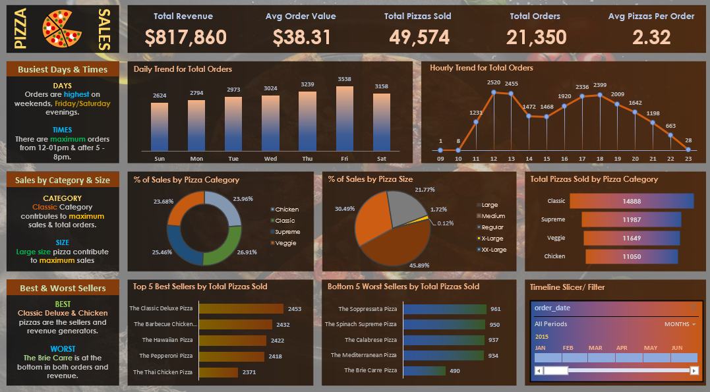

# 🍕 Pizza Sales Analysis: End-to-End Data Analytics Project


A complete business analytics project that turns **one year of pizza-restaurant transactions (48,620 line items, 21,350 orders)** into KPIs, dashboards and actionable recommendations, using **SQL, Python, Excel, Power BI and Tableau** on the same dataset with consistent KPI definitions.

**Quick links:**
[📊 Dashboards](#-dashboards) · [🔑 Key Findings](#-key-findings-in-30-seconds) · [📈 Detailed Insights](#-detailed-insights) · [💡 Recommendations](#-business-recommendations) · [🛠️ How to Run](#-how-to-run--explore) · [📁 Structure](#-repository-structure) · [⚠️ Limitations](#-data-limitations)

---

## 📊 Dashboards

The same business questions are answered in three BI tools, so the results can be cross-checked.

### Power BI


<details>
<summary>More dashboards (click to expand)</summary>

**Power BI: Best & Worst Sellers**


**Tableau: Home**


**Tableau: Best & Worst Sellers**


**Excel Dashboard**



</details>

---

## 🔑 Key Findings in 30 Seconds

| Question | Answer |
|---|---|
| How much was sold? | **$817,860** revenue, **21,350** orders, **49,574** pizzas |
| Best category? | **Classic**, with $220K (26.9% of revenue) and the most pizzas sold (14,888) |
| Best size? | **Large**, with 45.9% of revenue |
| Best day? | **Friday**, with $136K, which is 37% higher than Sunday (the weakest day) |
| Peak hours? | **12:00-13:59** and **17:00-18:59**, which together bring **45.5% of all orders** |
| Best / worst month? | **July** ($72.6K) / **October** ($64.0K), a 13% gap |
| Best-selling pizza (revenue)? | **The Thai Chicken Pizza**, $43.4K |
| Weakest pizza? | **The Brie Carre Pizza**, $11.6K and the lowest orders and quantity |
| Most-used ingredients? | **Garlic** and **Tomatoes** (about 27K pizzas each) |

---

## 📌 Project Overview

This project analyses pizza sales from **1 January 2015 to 31 December 2015** to evaluate revenue, order behaviour, product performance, sales trends, category and size preferences, and ingredient usage.

The analytics lifecycle followed:

> **Business Understanding → Requirements → Data → SQL → Python → Excel → Power BI → Tableau → Insights → Recommendations**

The aim is not only to compute metrics, but to turn them into practical recommendations for **staffing, inventory planning, menu optimisation, product strategy and promotion testing**.

---

## 🎯 Business Problem

The business generates a large volume of transactions but lacks a structured view of sales performance and ordering patterns. Management needs to know:

- How much revenue, how many orders and how many pizzas were sold, and what is the average order value?
- Which categories, sizes and pizzas drive revenue, and which underperform?
- Which days, hours and months generate the highest demand?
- Which ingredients are used most often?
- What actions could improve operational and commercial performance?

---

## 📊 Executive KPI Summary

| KPI | Result | Definition |
|---|---:|---|
| **Total Revenue** | **$817,860.05** | Sum of `total_price` |
| **Total Orders** | **21,350** | Distinct `order_id` |
| **Total Pizzas Sold** | **49,574** | Sum of `quantity` |
| **Average Order Value (AOV)** | **$38.31** | Total revenue ÷ total orders |
| **Average Pizzas per Order** | **2.32** | Total pizzas ÷ total orders |
| **Median Order Value** | **$32.50** | Middle value of order totals (AOV is pulled up by large orders, up to $444.20) |
| **Pizza Varieties** | **32** | Distinct `pizza_name` |
| **Line-Item Records** | **48,620** | Rows in the dataset (one row per pizza line on an order) |
| **Trading Days in Data** | **358** | Dates with at least one order within 2015 |
| **Average Daily Revenue** | **$2,284.53** | Revenue ÷ trading days |

> **Why 48,620 rows but 21,350 orders?** Each row is a pizza line on an order, and one order can contain several lines. Orders are counted with `COUNT(DISTINCT order_id)`.
>
> **Revenue is not profit.** Product costs and operating expenses are not in the dataset.

---

## 📈 Detailed Insights

### 1. Category performance

| Category | Revenue | Revenue share | Pizzas sold | Orders* |
|---|---:|---:|---:|---:|
| Classic | $220,053.10 | 26.9% | 14,888 | 10,859 |
| Supreme | $208,197.00 | 25.5% | 11,987 | 9,085 |
| Chicken | $195,919.50 | 24.0% | 11,050 | 8,536 |
| Veggie | $193,690.45 | 23.7% | 11,649 | 8,941 |

\*An order can contain several categories, so category order counts add up to more than 21,350. Revenue shares are rounded.

**Insight:** Revenue is evenly spread (a 3.2 percentage-point gap between first and last). Classic leads on both revenue and volume, while Chicken earns more revenue per pizza than Veggie despite selling fewer pizzas than Veggie.

### 2. Size performance

| Size | Revenue | Revenue share | Pizzas sold |
|---|---:|---:|---:|
| Large (L) | $375,318.70 | 45.9% | 18,956 |
| Medium (M) | $249,382.25 | 30.5% | 15,635 |
| Small (S) | $178,076.50 | 21.8% | 14,403 |
| XL | $14,076.00 | 1.7% | 552 |
| XXL | $1,006.60 | 0.1% | 28 |

**Insight:** Large pizzas generate almost half of revenue. XL and XXL together account for only 1.8% of revenue (580 pizzas), so they are candidates for a review of whether they justify their menu space and ingredient and packaging complexity. *(Dashboards label the "S" size as "Regular".)*

### 3. Best-performing pizzas

| Rank | By revenue | Revenue | By quantity | Pizzas |
|---:|---|---:|---|---:|
| 1 | The Thai Chicken Pizza | $43,434.25 | The Classic Deluxe Pizza | 2,453 |
| 2 | The Barbecue Chicken Pizza | $42,768.00 | The Barbecue Chicken Pizza | 2,432 |
| 3 | The California Chicken Pizza | $41,409.50 | The Hawaiian Pizza | 2,422 |
| 4 | The Classic Deluxe Pizza | $38,180.50 | The Pepperoni Pizza | 2,418 |
| 5 | The Spicy Italian Pizza | $34,831.25 | The Thai Chicken Pizza | 2,371 |

**Insight:** The top 5 pizzas by revenue bring in **24.5%** of all revenue. Three of them are Chicken pizzas: they top revenue because of higher prices, even though Classic Deluxe, Hawaiian and Pepperoni sell more units. Revenue leaders and volume leaders are different groups, which matters for pricing and promotion decisions.

### 4. Lower-performing pizzas

| Rank (lowest first) | By revenue | Revenue | By quantity | Pizzas |
|---:|---|---:|---|---:|
| 1 | The Brie Carre Pizza | $11,588.50 | The Brie Carre Pizza | 490 |
| 2 | The Green Garden Pizza | $13,955.75 | The Mediterranean Pizza | 934 |
| 3 | The Spinach Supreme Pizza | $15,277.75 | The Calabrese Pizza | 937 |
| 4 | The Mediterranean Pizza | $15,360.50 | The Spinach Supreme Pizza | 950 |
| 5 | The Spinach Pesto Pizza | $15,596.00 | The Soppressata Pizza | 961 |

**Insight:** The Brie Carre Pizza is last on every measure and sells about half as much as the next-weakest pizza (490 vs 934). The bottom 5 by revenue contribute only **8.8%** of revenue. Low revenue alone is **not** enough to remove a product: margin, ingredient cost and menu role must be checked first.

### 5. Day-of-week performance

| Day | Revenue | Orders |
|---|---:|---:|
| Friday | $136,073.90 | 3,538 |
| Thursday | $123,528.50 | 3,239 |
| Saturday | $123,182.40 | 3,158 |
| Wednesday | $114,408.40 | 3,024 |
| Tuesday | $114,133.80 | 2,973 |
| Monday | $107,329.55 | 2,794 |
| Sunday | $99,203.50 | 2,624 |

**Insight:** Demand builds through the week and peaks on **Friday**, with Thursday and Saturday close behind. Sunday is the weakest day, so "weekend" does not mean uniformly strong demand.

### 6. Hourly performance

| Hour | Orders | Revenue |
|---:|---:|---:|
| 11:00 | 1,231 | $44,935.80 |
| **12:00** | **2,520** | **$111,877.90** |
| **13:00** | **2,455** | **$106,065.70** |
| 14:00 | 1,472 | $59,201.40 |
| 15:00 | 1,468 | $52,992.30 |
| 16:00 | 1,920 | $70,055.40 |
| **17:00** | **2,336** | **$86,237.45** |
| **18:00** | **2,399** | **$89,296.85** |
| 19:00 | 2,009 | $72,628.90 |
| 20:00 | 1,642 | $58,215.40 |
| 21:00 | 1,198 | $42,029.80 |
| 22:00 | 663 | $22,815.15 |
| 23:00 | 28 | $1,121.35 |

Hours 09:00 and 10:00 together have only 9 orders, so they are not shown above.

**Insight:** There are two clear peaks: a **lunch peak (12:00-13:59)** and an **evening peak (17:00-18:59)**, with a dip at 14:00-15:59 between them. These four hours produce **45.5% of all orders**.

### 7. Monthly performance

| Month | Revenue | Orders | Pizzas |
|---|---:|---:|---:|
| Jan | $69,793.30 | 1,845 | 4,232 |
| Feb | $65,159.60 | 1,685 | 3,961 |
| Mar | $70,397.10 | 1,840 | 4,261 |
| Apr | $68,736.80 | 1,799 | 4,151 |
| May | $71,402.75 | 1,853 | 4,328 |
| Jun | $68,230.20 | 1,773 | 4,107 |
| **Jul** | **$72,557.90** | **1,935** | **4,392** |
| Aug | $68,278.25 | 1,841 | 4,168 |
| Sep | $64,180.05 | 1,661 | 3,890 |
| **Oct** | **$64,027.60** | **1,646** | **3,883** |
| Nov | $70,395.35 | 1,792 | 4,266 |
| Dec | $64,701.15 | 1,680 | 3,935 |

**Insight:** July is the strongest month and October the weakest, a gap of about 13%. February, September, October and December are all below $66K. With one year of data, seasonality cannot be confirmed, only observed. Months also differ in length and number of trading days.

### 8. Ingredient analysis

The 32 pizzas use **65 distinct ingredients**. Counting how many pizzas sold contained each ingredient (weighted by quantity):

| Rank | Ingredient | Pizzas containing it |
|---:|---|---:|
| 1 | Garlic | 27,913 |
| 2 | Tomatoes | 27,052 |
| 3 | Red Onions | 19,834 |
| 4 | Red Peppers | 16,562 |
| 5 | Mozzarella Cheese | 10,569 |
| 6 | Pepperoni | 10,540 |
| 7 | Spinach | 10,166 |
| 8 | Mushrooms | 9,729 |
| 9 | Chicken | 8,618 |
| 10 | Capocollo | 6,692 |

**Insight:** Garlic and Tomatoes appear in over half of all pizzas sold (49,574), which makes them the highest-priority items for stock monitoring. *This measures occurrences, not grams or cost: the dataset has no ingredient quantities.*

---

## 💡 Business Recommendations

| # | Recommendation | Evidence | Metric to track |
|---|---|---|---|
| 1 | **Staff to the two daily peaks** (12:00-13:59 and 17:00-18:59) and to Thursday-Saturday | 45.5% of orders fall in 4 hours; Friday is 37% above Sunday | Orders per staff hour |
| 2 | **Protect stock of high-use ingredients** (Garlic, Tomatoes, Red Onions, Red Peppers) before peak days | These appear in the highest number of pizzas sold | Stock-outs per week |
| 3 | **Feature high-revenue pizzas** (Thai Chicken, BBQ Chicken, California Chicken) in bundles and menu highlights | Top 5 bring 24.5% of revenue | Revenue per featured item |
| 4 | **Review, don't automatically remove, the weakest pizzas** (start with Brie Carre) using margin, ingredient cost and feedback | Bottom 5 bring 8.8% of revenue; Brie Carre sells about half of the next-lowest pizza | Margin per pizza |
| 5 | **Run controlled promotions on weak periods** (Sunday, 14:00-15:59, September-October) against a baseline | These are the lowest-demand periods | Uplift vs baseline |
| 6 | **Test bundles to raise basket size** | Average order has 2.32 pizzas; median order is $32.50 | AOV, pizzas per order |
| 7 | **Review XL / XXL menu space** | 1.8% of revenue from 580 pizzas | Revenue per menu item |
| 8 | **Keep a KPI dashboard live** | Revenue, orders, AOV, pizzas per order, category, product, day and hour | Monthly review |

---

## 🧠 Analytical Approach & Tools

| Phase | Tool | What was done | Output |
|---|---|---|---|
| 01 Business Analysis | Markdown | Problem, objectives, requirements, KPIs, business questions | `01_Business_Analysis/` |
| 02 Data | CSV / Excel | Reviewed structure, types, missing values, duplicates, date and time fields | `02_Data/` |
| 03 SQL | SQL Server (T-SQL) | KPIs, hourly and weekly trends, category and size %, top/bottom 5 pizzas | `03_SQL/` |
| 04 Python | pandas, matplotlib, seaborn | Validation, EDA, KPIs, time, category, product and ingredient analysis | `04_Python/` |
| 05 Excel | Excel | PivotTables, KPIs, slicer-driven dashboard | `05_Excel/` |
| 06 Power BI | Power BI Desktop | Interactive dashboard (Home, Best/Worst Sellers) | `06_Power_BI/` |
| 07 Tableau | Tableau | Interactive dashboard (Home, Best/Worst Sellers) | `07_Tableau/` |
| 08 Insights | Markdown | Findings and recommendations | `08_Insights_and_Recommendations/` |
| 09 Documentation | Word / PDF | BRD, final report, screenshots | `09_Documentation/` |

**Data quality check:** 48,620 rows, 12 columns, **no missing values and no duplicate rows**.

**Dataset columns:** `pizza_id`, `order_id`, `pizza_name_id`, `quantity`, `order_date`, `order_time`, `unit_price`, `total_price`, `pizza_size`, `pizza_category`, `pizza_ingredients`, `pizza_name`.

---

## 🛠️ How to Run / Explore

1. **Clone the repository**
   ```bash
   git clone https://github.com/aryanmusmade5-dev/Pizza-Sales-Analysis.git
   cd Pizza-Sales-Analysis
   ```
2. **SQL:** open `03_SQL/` in SQL Server Management Studio, import `02_Data/Raw/pizza_sales.csv` into a table named `pizza_sales`, then run the queries.
3. **Python:**
   ```bash
   pip install pandas numpy matplotlib seaborn jupyter
   jupyter notebook 04_Python/Pizza_Sales_Analysis.ipynb
   ```
4. **Excel:** open `05_Excel/Pizza Dashboard.xlsx` (use the timeline slicer to filter by month).
5. **Power BI:** open `06_Power_BI/Pizza Sales Dashboard.pbix` in Power BI Desktop (free).
6. **Tableau:** open `07_Tableau/Pizza Sales.twbx` in Tableau Desktop or Tableau Public.

---

## 📁 Repository Structure

```text
Pizza-Sales-Analysis/
├── README.md
├── 01_Business_Analysis/
│   ├── README.md
│   ├── Business-Problem.md
│   ├── Business-Requirements.md
│   ├── KPIs.md
│   └── Business-Questions.md
├── 02_Data/
│   ├── Raw/
│   │   ├── pizza_sales.csv
│   │   └── pizza_sales.xlsx
│   └── Data_Dictionary.md
├── 03_SQL/
│   ├── pizza_sales_queries.sql
│   ├── PIZZA SALES SQL QUERIES.docx
│   └── README.md
├── 04_Python/
│   ├── Pizza_Sales_Analysis.ipynb
│   ├── requirements.txt
│   └── README.md
├── 05_Excel/
│   ├── Pizza Dashboard.xlsx
│   └── README.md
├── 06_Power_BI/
│   ├── Pizza Sales Dashboard.pbix
│   ├── Dashboard_Screenshot.png
│   └── README.md
├── 07_Tableau/
│   ├── Pizza Sales.twbx
│   ├── Dashboard_Screenshot.png
│   └── README.md
├── 08_Insights_and_Recommendations/
│   ├── Business_Insights.md
│   ├── Recommendations.md
│   └── Final_Report.md
└── 09_Documentation/
    ├── BRD/
    │   └── Business_Requirements_Document.docx
    ├── Project_Documentation/
    │   └── Pizza_Sales_Analysis_Report.pdf
    └── Screenshots/
        ├── 01_PowerBI_Main_Dashboard.png
        ├── 02_PowerBI_Best_Worst_Sellers.png
        ├── 03_Tableau_Main_Dashboard.png
        ├── 04_Tableau_Best_Worst_Sellers.png
        └── 05_Excel_Dashboard.png
```

**Full documents:**
[Project Report (PDF)](09_Documentation/Project_Documentation/Pizza_Sales_Analysis_Report.pdf) · [Business Requirements Document](09_Documentation/BRD/Business_Requirements_Document.docx)

---

## ⚠️ Data Limitations

- **One year only (2015):** year-over-year trends and confirmed seasonality are not possible.
- **No cost data:** profit, margin and true product profitability cannot be calculated.
- **No customer or location data:** retention, customer segments and store comparisons are not possible.
- **No promotion or marketing data:** the causes of sales patterns cannot be established; findings show *what* happened, not *why*.
- **No ingredient quantities or costs:** ingredient analysis counts pizzas containing an ingredient, not actual consumption.
- **358 trading days:** some dates in 2015 have no orders, so monthly and daily comparisons should account for this.

---

## 🎓 Skills Demonstrated

Business requirement gathering · KPI design · Data validation and cleaning · SQL (aggregation, time analysis, ranking) · Python EDA · Data visualisation · Dashboard design in Excel, Power BI and Tableau · Insight generation · Recommendation writing · Technical documentation

---

## 👤 Author

**Aryan Musmade**: Data Analytics Intern at Bitlogic System | Aspiring Data Analyst

B.E. in Electronics and Telecommunication Engineering, MMCOE College of Engineering, Pune

- **LinkedIn:** [linkedin.com/in/contact-aryanmusmadee](https://www.linkedin.com/in/contact-aryanmusmadee)
- **GitHub:** [github.com/aryanmusmade5-dev](https://github.com/aryanmusmade5-dev)

---

*Developed as a data analytics capstone project to demonstrate practical skills in business analysis, SQL, Python, Excel, Power BI, Tableau and business communication. Revenue figures are in USD as recorded in the source data.*
